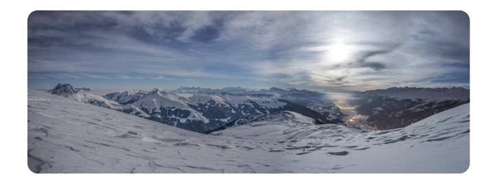

 

  

<h1 align="center">
  <a href="https://pnutsec.tech/">CLICK HERE FOR THE BEST WEBSITE EVER</a>
</h1>

  <samp>ALPINISM · MTB · CYBERSECURITY</samp>

  
  
  

  <samp>explore the mountains. ride beyond limits. understand the machine.</samp>

<h3 align="center">01 / about me</h3>

  Interested in cybersecurity, the outdoors and technology.
   
  Happiest somewhere between the mountains, a bike trail and a terminal.
   
  Always learning. Always exploring.

  <code>curiosity is the best tool.</code>

<h3 align="center">02 / outdoor life</h3>

  
  
  
  

  <strong>ALPINISM</strong>
   
  High mountains, challenging routes and the beauty of the wilderness.

  <strong>DIRT JUMP & XC</strong>
   
  Two wheels, dirt trails, jumps and time outside.

  <strong>SKIING</strong>
   
  Winter mountains, speed and fresh snow.

<h3 align="center">03 / cybersecurity</h3>

  
  
  

  Interested in web security, vulnerability research and learning how systems work.
   
  Focused on responsible disclosure and improving security.

  <code>observe · investigate · learn · report responsibly</code>

<h3 align="center">04 / red bull bug bounty</h3>

  

  Big fan of Red Bull, its action-sports culture and mountain projects.
   
  I do bug bounty research for Red Bull, looking for vulnerabilities
   
  and helping improve the security of its digital assets.

  <code>research · responsible disclosure · cybersecurity</code>

  Independent security research · not a Red Bull employee.

<h3 align="center">05 / achievements</h3>

  

  Won a Raspberry Pi 5 · 35 days ago

<h3 align="center">06 / crypto wallets</h3>

  

  <code>DAWbGHUphZGqcWYReat9cca5aUthU6hULG</code>

  

  <code>0x44ec8C4526D0E563357Ad23526c66094A8605ece</code>

<h3 align="center">07 / website</h3>

  <a href="https://pnutsec.tech/">CLICK HERE FOR THE BEST WEBSITE EVER</a>

  <samp>LAST UPDATE · 31.10.2026</samp>
    
  find your line. take the trail. explore the unknown.

